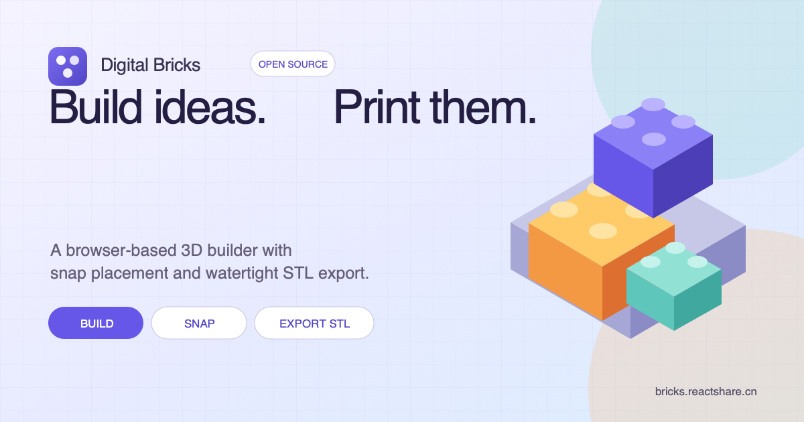

# Digital Bricks

A browser-based 3D construction editor for kids, families, and makers. Drag generic parts into the scene, let gravity place them on the build plate, and bring compatible connectors together to snap. Save a project as `.legox`, publish it to the community Gallery, or export a watertight STL for slicing and 3D printing.

**[Try Digital Bricks](https://bricks.reactshare.cn/en/start?utm_source=github&utm_medium=referral&utm_campaign=launch_202610&utm_content=github_readme)** · [Open the builder](https://bricks.reactshare.cn/en/build?utm_source=github&utm_medium=referral&utm_campaign=launch_202610&utm_content=github_readme) · [Explore the Gallery](https://bricks.reactshare.cn/en/plaza?utm_source=github&utm_medium=referral&utm_campaign=launch_202610&utm_content=github_readme) · [中文说明](./README.md)



## What it does

- 35 procedurally generated generic parts across blocks, plates, round parts, slopes, frames, curves, and moving parts
- Explicit connector frames with quaternion-based alignment
- Deterministic gravity placement, collision checks, and snap previews
- Move, quarter-turn rotation, flip, duplicate, multi-select, undo, and redo
- Local browser saving and `.legox` project import/export
- Manifold union into a single watertight binary STL
- Print-bed, floating-part, and basic overhang warnings
- A public Gallery with creator credit, likes, reports, and source-preserving remixes
- Passkey accounts for publishing; building, local saving, and STL export require no account

Digital Bricks uses an original part scale and connector system. It does not claim compatibility with any physical construction-toy brand.

## Generate a draft with AI

The project publishes a [Digital Bricks modeling skill](https://bricks.reactshare.cn/digital-bricks-modeling-skill.md). Give the following prompt to ChatGPT or another AI that can read public URLs:

```text
Read https://bricks.reactshare.cn/digital-bricks-modeling-skill.md and follow its rules exactly to generate a .legox model file for Digital Bricks. Use only the brick types defined in the Skill. Do not add new brick definitions, STL data, meshes, or explanatory text. Return only a complete, valid .legox file. Model request: build a small house with a door, windows, and a roof.
```

Save the response as a `.legox` file, open it from the editor toolbar, and continue moving, recoloring, connecting, or exporting the model.

## Local development

Requires Node.js 20 or newer.

```bash
npm install
npm run dev
```

Run the production build and tests with:

```bash
npm run build
npm test
```

The community features use Better Auth Passkey and MySQL/TiDB. Without server environment variables, the browser editor, local storage, `.legox` files, and STL export continue to work independently.

See the live [Data & Privacy](https://bricks.reactshare.cn/en/privacy.html) page for details about local projects, account data, essential cookies, public creations, and anonymous campaign measurement.
