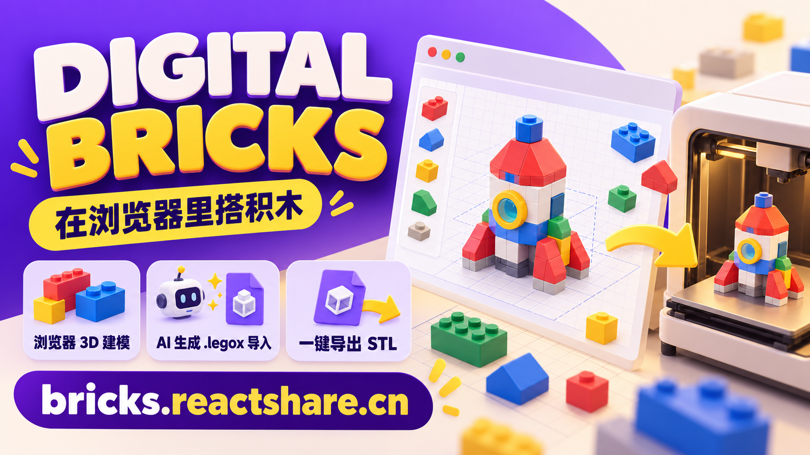

# 数字积木 · Digital Bricks

**[English README](./README.en.md)** · **[English live demo](https://bricks.reactshare.cn/en/start?utm_source=github&utm_medium=referral&utm_campaign=launch_202610&utm_content=github_readme)**

给孩子、家长和创客使用的浏览器 3D 积木工具。拖入积木后会自动落位和卡接，完成的作品可以保存为 `.legox`、发布到作品广场，或导出无内部接缝的 STL 去 3D 打印。

**[在线体验](https://bricks.reactshare.cn/start?utm_source=github&utm_medium=referral&utm_campaign=launch_202610)** · [直接开始搭建](https://bricks.reactshare.cn/build?utm_source=github&utm_medium=referral&utm_campaign=launch_202610) · [浏览作品广场](https://bricks.reactshare.cn/plaza?utm_source=github&utm_medium=referral&utm_campaign=launch_202610)



## 它适合谁

- 想让孩子接触空间结构、设计和 3D 打印的家长与老师
- 不想先学习复杂 CAD，只想快速把想法搭出来的创客
- 想用 AI 生成一个积木草稿，再亲手调整和打印的人
- 喜欢分享作品、从别人作品继续二创的数字积木玩家

开始搭建、保存本机作品和导出 STL 都不需要账户，也不需要安装软件。

## 能做什么

- 35 种原创通用积木，覆盖方块、板件、圆件、斜面、框架与机械件
- 基于显式连接器和四元数对齐的自动吸附
- 确定性重力落位、接触面预测、防穿透与吸附预览
- 移动、90° 旋转、复制、多选、撤销和重做
- 中英文浮雕文字：选择小/中/大，拖到平整面贴上，固定凸起 1.2 mm，随积木保存、复制并导出 STL
- 本机保存、`.legox` 文件导入导出
- Manifold 实体并集，生成无内部接缝的二进制 STL
- 打印尺寸、越界、悬浮和基础悬垂提醒
- 作品广场、作者空间、喜欢、举报和保留来源的二创
- Passkey 账户与首次发布监护 PIN；浏览和创作无需登录

> Digital Bricks 使用原创尺寸与连接系统，不声明兼容任何实体积木品牌。

## 让 AI 帮你搭草稿

项目提供一份公开的 [Digital Bricks AI 建模规则](https://bricks.reactshare.cn/digital-bricks-modeling-skill.md)。把下面这段话交给能够读取公开网址的 ChatGPT 或其他 AI：

```text
请阅读 https://bricks.reactshare.cn/digital-bricks-modeling-skill.md，并严格遵循其中的规则，为 Digital Bricks 生成一个 .legox 模型文件。只使用 Skill 中已有的积木，不要新增积木定义、STL、网格或说明文字。请只返回完整、有效的 .legox 文件。模型要求：生成一座带门窗和屋顶的小房子。
```

下载生成的 `.legox` 文件，在顶部工具栏选择“打开”，就可以继续移动、换色、连接或导出 STL。

## 本地开发

需要 Node.js 20+。

```bash
npm install
npm run dev
```

验证生产构建和测试：

```bash
npm run build
npm test
```

主要目录：

- `src/bricks/`：数据驱动的积木目录与程序化几何
- `src/editor/`：吸附、重力、碰撞、移动、选择与项目文件
- `src/export/`：Manifold STL 合并与导出
- `src/components/`：编辑器、作品社区与推广落地页
- `api/`、`server/`：账户、作品社区和 ECS 运行时
- `public/`：SEO、隐私说明、AI 建模规则和分享素材
- `marketing/launch/`：首发图片、渠道文案与 UTM 链接

## 文字字体资产

文字采用固定 600 字重的 Noto Sans SC 轮廓，按 Unicode 字形分包按需加载；输入时预取，并复用并发请求与浏览器缓存。无文字的作品不会下载字体。

`public/fonts/NotoSansSC.ttf` 保留用于旧版页面兼容和资产再生成，新版不会整包请求它。分包已提交到 Git，正常 `npm install` / 构建不需要 Python；仅更新字体资产时，在本地安装 `fonttools==4.60.1` 并运行 `python scripts/build-text-fonts.py`，同时保留 `public/fonts/OFL.txt`。更换分包规则或字体时需递增 `text-600-v1` 目录版本，避免缓存混用。

## 作品社区配置

ECS 部署在开发机执行 `npm run build:ecs`，上传 `dist/` 与 `server-dist/`，再重启 `legox.service`。API 已打包为独立的 Node.js 24 程序；ECS 无需安装依赖、构建或测试，避免影响同机的其它站点。

作品社区使用 Better Auth Passkey 和 MySQL/TiDB。未配置服务端环境变量时，浏览器建模、`localStorage`、`.legox` 文件与 STL 导出仍可独立使用。

```bash
cp .env.example .env.local
# 填写 DATABASE_URL、BETTER_AUTH_SECRET、ACCOUNT_CONTEXT_SECRET 等变量
npm run db:migrate
npm run dev
```

不要把真实凭证提交到 Git。生产部署还需要把 `BETTER_AUTH_URL` 设为正式站点地址，并让 `WEBAUTHN_RP_ID` 与域名一致。

## 搜索收录

部署完成后可以把首页、推广页、广场和隐私说明提交给支持 IndexNow 的搜索引擎：

```bash
npm run seo:submit
```

[数据与隐私说明](https://bricks.reactshare.cn/privacy.html)列出了本机数据、账户数据、必要 Cookie 和公开作品的处理方式。
